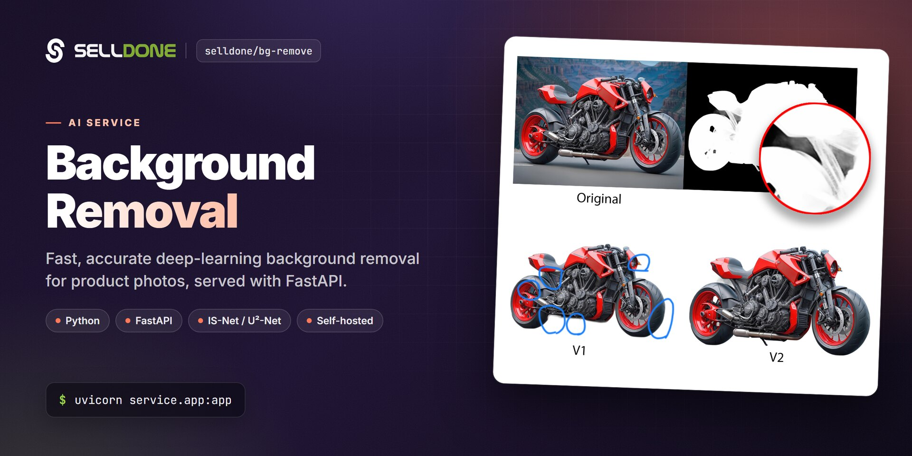
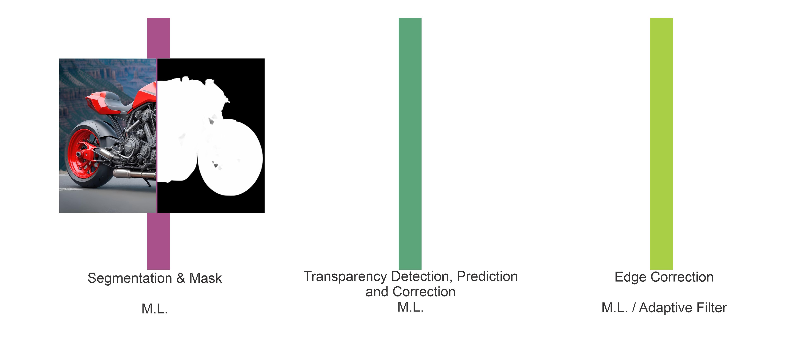
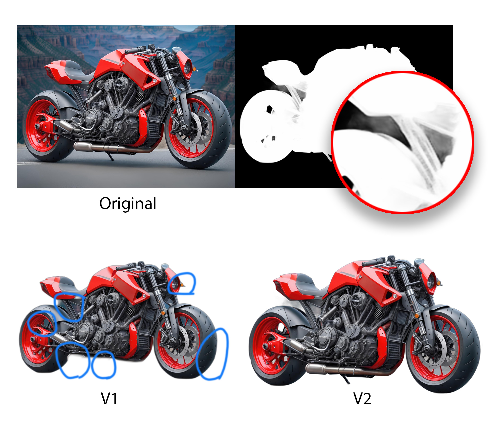

<p align="center">
  
</p>

<p align="center">
  <a href="LICENSE"></a>
  <a href="https://github.com/selldone/bg-remove/wiki"></a>
  <a href="https://selldone.com"></a>
</p>

<p align="center">
  <b>A self-hosted FastAPI service that removes image backgrounds with deep learning (IS-Net / U²-Net), for developers who need clean product photos.</b><br>
  <a href="https://github.com/selldone/bg-remove/wiki">Documentation</a> ·
  <a href="#quick-start">Quick start</a> ·
  <a href="https://github.com/selldone">Ecosystem</a> ·
  <a href="https://selldone.com">Selldone.com</a> ·
  <a href="https://github.com/selldone/bg-remove/issues">Report an issue</a>
</p>

<p align="center">
  <a href="https://github.com/selldone/storefront">Storefront</a> ·
  <a href="https://github.com/selldone/pagebuilder">Page Builder</a> ·
  <a href="https://github.com/selldone/components">Components</a> ·
  <a href="https://github.com/selldone/storefront-sdk">Storefront SDK</a> ·
  <a href="https://github.com/selldone/backoffice-sdk">Backoffice SDK</a> ·
  <a href="https://github.com/selldone/vendor-sdk">Vendor SDK</a> ·
  <a href="https://github.com/selldone/community-sdk">Community SDK</a> ·
  <a href="https://github.com/selldone/core">Core</a> ·
  <a href="https://github.com/selldone/cli">CLI</a> ·
  <a href="https://github.com/selldone/translate">Translate</a>
</p>

## Overview

**Selldone®** Background Removal is an open-source service that removes the background from an image using deep learning, with an emphasis on speed and accuracy. Our goal is a ready-to-use, free tool for developers. It wraps pre-trained models from the open-source community — **IS-Net** (DIS) and **U²-Net** — in a small [FastAPI](https://fastapi.tiangolo.com/) application.

You send an image to one HTTP endpoint and get back a PNG with a transparent background, the same size as the original. This is the kind of processing an online store needs for product photos, and it fits naturally next to **Selldone Business OS**, where clean product images improve every storefront.

Use it if you want to run background removal on your own hardware (CPU or NVIDIA GPU), integrate it into an image pipeline, or study a minimal, production-style inference API for segmentation models.

## Key features

- **One simple endpoint** — `POST /remove-bg` with a multipart `file`; the response is a transparent PNG.
- **Two models** — IS-Net (`isnet-general-use.pth`, recommended) and the earlier U²-Net, each with its own app.
- **Original resolution** — the predicted mask is resized back to the input size, so the output matches the original dimensions.
- **GPU when available** — the IS-Net engine runs on CUDA automatically and falls back to CPU.
- **Timing headers** — every response reports `S-Processing-Time`, plus `S-Processing-Device` (`cuda` or `cpu`) for IS-Net.
- **In-memory processing** — uploads are processed in memory buffers; nothing is written to disk.
- **Clear errors** — failures return HTTP `400` with `{ "error": "..." }`.
- **Interactive API docs** — FastAPI's built-in Swagger UI is available at `/docs`.

## Screenshots

<p align="center">
  
</p>

<p align="center">
  
</p>

## Quick start

Requirements: Python 3 with `pip`. An NVIDIA GPU with CUDA is optional.

```bash
# 1. Clone the repository
git clone https://github.com/selldone/bg-remove.git
cd bg-remove

# 2. Install dependencies
pip install -r requirements.txt

# 3. Download the IS-Net model into service/isnet/model/
mkdir -p service/isnet/model
gdown 1XHIzgTzY5BQHw140EDIgwIb53K659ENH -O service/isnet/model/isnet-general-use.pth

# 4. Start the service (run from the repository root)
uvicorn service.app:app --host localhost --port 8000
```

You can also download the model manually from [Google Drive](https://drive.google.com/file/d/1XHIzgTzY5BQHw140EDIgwIb53K659ENH/view?usp=sharing) and place `isnet-general-use.pth` in `service/isnet/model/`.

Remove a background:

```bash
curl -X POST -F "file=@product.jpg" http://localhost:8000/remove-bg --output product.png
```

## Usage

### Endpoint

| Method | Endpoint | Description |
|---|---|---|
| `POST` | `http://localhost:8000/remove-bg` | Remove the background of the uploaded image. |

**Request** — `multipart/form-data` with one field:

| Field | Type | Required | Description |
|---|---|---|---|
| `file` | file | yes | The source image (for example JPEG or PNG). |

**Success response** — `200 OK`, body is the processed image streamed as `image/png` (RGBA, transparent background).

| Header | Example | Description |
|---|---|---|
| `S-Processing-Time` | `0.84` | Processing time in seconds. |
| `S-Processing-Server` | `V1` | Server version tag. |
| `S-Processing-Device` | `cuda` | IS-Net app only: device used for inference (`cuda` or `cpu`). |

**Error response** — `400 Bad Request` with a JSON body:

```json
{ "error": "<exception message>" }
```

### Models

| | IS-Net (new, recommended) | U²-Net (old) |
|---|---|---|
| App module | `service.app:app` | `service.app_u2net:app` |
| Weights file | `service/isnet/model/isnet-general-use.pth` | `service/u2net/model/u2net.pth` |
| Network | `ISNetDIS` | `U2NET(3, 1)` |
| Inference size | 1024 × 1024 | 320 × 320 (mask refined in 4 passes) |
| Device | CUDA if available, otherwise CPU | CPU |

Start either app on port 8000:

```bash
# ISNET (NEW)
uvicorn service.app:app --host localhost --port 8000

# U2NET (OLD)
uvicorn service.app_u2net:app --host localhost --port 8000
```

The model paths are relative (`./service/...`), so always start `uvicorn` from the repository root. The U²-Net weights (`u2net.pth`) are not included; download them from the official [U-2-Net repository](https://github.com/xuebinqin/U-2-Net). Weight files (`*.pth`) are ignored by Git.

### Project structure

```text
bg-remove/
├── requirements.txt          # torch, torchvision, fastapi, uvicorn, pillow, scikit-image, gdown, ...
└── service/
    ├── app.py                # FastAPI app using IS-Net
    ├── app_u2net.py          # FastAPI app using U²-Net
    ├── isnet/
    │   ├── engine_isnet.py   # model loading, inference, mask compositing
    │   ├── model_isnet.py    # ISNetDIS network definition
    │   ├── data_loader_cache.py
    │   └── model/            # put isnet-general-use.pth here
    └── u2net/
        ├── engine_u2net.py
        ├── model_u2net.py
        ├── utils_u2net.py
        └── model/            # put u2net.pth here
```

## Documentation

| Page | What you'll learn |
|---|---|
| [Home](https://github.com/selldone/bg-remove/wiki) | What the service does and how it is organized. |
| [Getting Started](https://github.com/selldone/bg-remove/wiki/Getting-Started) | Install, download the model, run and call the API. |
| [API Reference](https://github.com/selldone/bg-remove/wiki/API-Reference) | Request, response, headers and errors of `/remove-bg`. |
| [Models](https://github.com/selldone/bg-remove/wiki/Models) | IS-Net vs U²-Net, weights, inference settings. |
| [Client Examples](https://github.com/selldone/bg-remove/wiki/Client-Examples) | Calling the service from cURL, Python, JavaScript and PHP. |
| [Deployment](https://github.com/selldone/bg-remove/wiki/Deployment) | Running on a server, GPU, workers and reverse proxy. |
| [FAQ](https://github.com/selldone/bg-remove/wiki/FAQ) | Common questions and troubleshooting. |

## How it fits in the ecosystem

Background removal is an independent microservice: it has no dependency on other Selldone packages and can be used by any application. In a Selldone setup it is useful for preparing product images before they are uploaded with the [Backoffice SDK](https://github.com/selldone/backoffice-sdk) or shown in a [Storefront](https://github.com/selldone/storefront).

<p align="center">
  <a href="https://github.com/selldone#ecosystem"></a>
</p>

### Related projects

| Project | Why it is relevant |
|---|---|
| [backoffice-sdk](https://github.com/selldone/backoffice-sdk) | Upload processed images to products and variants. |
| [storefront](https://github.com/selldone/storefront) | Production-ready Vue 3 storefront that displays your product images. |
| [excel](https://github.com/selldone/excel) | Excel templates for bulk product import. |
| [gpt](https://github.com/selldone/gpt) | Build a custom GPT that reads your Selldone shops and products. |

## Credit

The IS-Net model and network code come from **Highly Accurate Dichotomous Image Segmentation (DIS)**: https://xuebinqin.github.io/dis/index.html. U²-Net is by the same author: https://github.com/xuebinqin/U-2-Net. Thanks to the authors for making their work open source.

## Contributing

Contributions are welcome. Please read the organization [contributing guide](https://github.com/selldone/.github/blob/main/CONTRIBUTING.md) and [code of conduct](https://github.com/selldone/.github/blob/main/CODE_OF_CONDUCT.md). Do not commit model weights (`*.pth`); they are ignored by Git.

## Security

Please do not report security vulnerabilities in public issues. Follow the [security policy](https://github.com/selldone/.github/blob/main/SECURITY.md) and email **security@selldone.com**.

## License

This project is licensed under the GNU General Public License v3.0. See [LICENSE](LICENSE) for the full text.

---
<p align="center"><sub>Part of the <a href="https://github.com/selldone">Selldone® Business OS</a> open-source ecosystem · <a href="https://selldone.com">selldone.com</a></sub></p>
